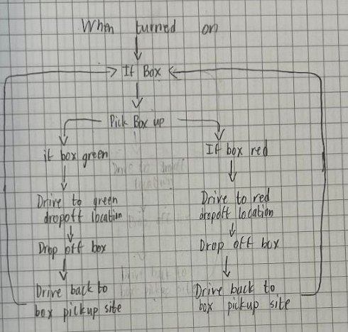

# AGV Machine Control

An automated guided vehicle (AGV) that picks up a box, identifies its color, delivers it to the matching drop-off zone, and returns to its starting point.

**PLTW Principles of Engineering, 2024–25** · team project · my role: **Control Logic Engineer**

[Project page](https://ahmedg-stack.github.io/projects/agv-machine-control.html)

## Behavior
1. Wait at the pickup site until a box is detected.
2. Pick up the box (without dragging it on the ground).
3. Read its color:
   - **Red:** drive to the drop-off on the **right**.
   - **Green:** drive to the drop-off on the **left**.
4. Drop off the box.
5. Return to the pickup site and repeat.

## My role
As Control Logic Engineer I wrote the pseudocode and the program logic: sensing, the color branch, and the return path. Teammates owned other parts of the build, and we put the parts together and tested as a team.

### Pseudocode
```
when turned on:
  loop:
    if box detected:
      pick up box
      if box is red:
        drive to red drop-off (right)
      else if box is green:
        drive to green drop-off (left)
      drop off box
      drive back to pickup site
```

### Flowchart


*Our team's flowchart (notebook page, 2025).*

## Design process
- **Research:** before designing, I studied five reference mechanisms and what sensors each would need: a VEX pulley lift, sidewalk delivery robots, warehouse robots, a Roomba (straight-line motion, obstacle detection, return to dock), and a pincer gripper.
- **Selection:** each of us sketched designs that met the constraints, and we picked one with a points-based vote.
- **Build:** we split up the subsystems, combined them, and went back to the drawing board several times before settling on a design that worked. We finished by writing the program and testing it repeatedly.

## Limitations
- **Hard-coded travel distances.** The program moved fixed amounts instead of reacting to what the robot sensed, so small errors in position added up.
- The lift used two motors where one was strong enough.

## What I'd do next
- Drive each wheel with its own motor for finer movement control.
- Remove the redundant lift motor.
- Replace the hard-coded distances with sensor-driven movement, so the robot decides how far to drive and turn based on its surroundings.
- On the team side: assign each person a specific subsystem early, and collect brainstormed ideas in a shared doc before discussing them so we don't duplicate ideas.

## Credits
Built as a team for PLTW Principles of Engineering.
